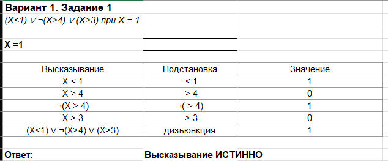
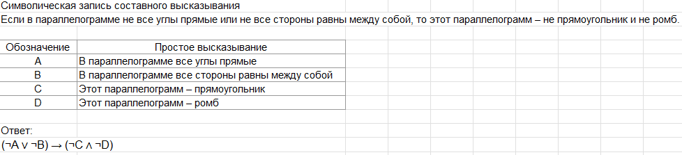
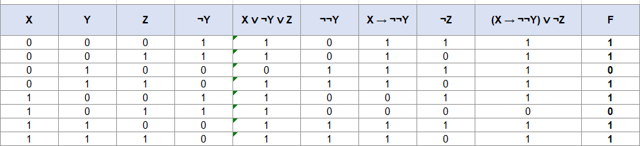
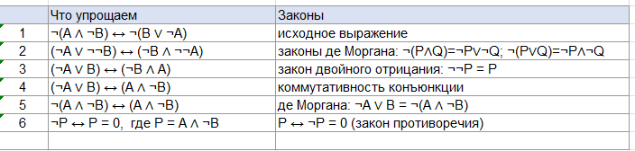
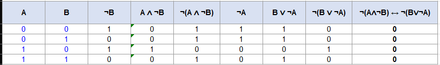

# Вариант 1

## Задание 1. Определите является ли высказывание истинным.

## Задание 2. Следующие составные высказывания расчлените на простые и запишите символически, введя буквенные обозначения для их простых составляющих.

## Задание 3. Постройте таблицу истинности для данного выражения.

## Задание 4.

